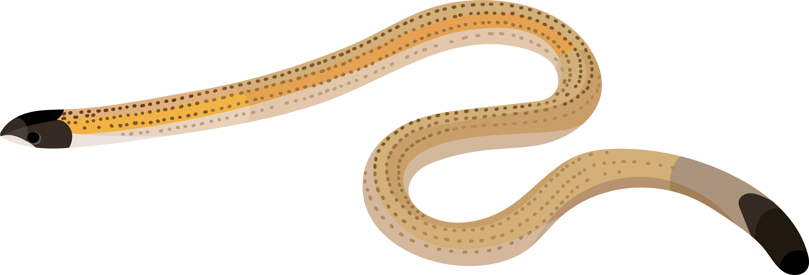

# Pygopodidae

This repository contains all data and scripts to reproduce the work presented in our study of Pygopodidae geckos [see BioRxiv](https://www.biorxiv.org/content/10.64898/2026.06.22.733657v2). It also includes figures, presentations, and past versions of the manuscript for completeness. Supplementary information (materials/methods, figures, tables) can be found in the most recent document in the [`Supplement/`](https://github.com/IanGBrennan/Pygopodidae/tree/main/Supplement) directory.

 

## Directories

### [`Alignments/`](https://github.com/IanGBrennan/Pygopodidae/tree/main/Alignments) 
- Sequence alignments and alignment summaries.

### [`Data/`](https://github.com/IanGBrennan/Pygopodidae/tree/main/Data) 
- Morphological, sampling, trait, and comparative-analysis data.

### [`Diet/`](https://github.com/IanGBrennan/Pygopodidae/tree/main/Diet) 
- Diet data, analyses, simulations, and results.

### [`Figures/`](https://github.com/IanGBrennan/Pygopodidae/tree/main/Figures) 
- Figures and figure assets organized by analysis.

### [`Manuscript/`](https://github.com/IanGBrennan/Pygopodidae/tree/main/Manuscript) 
- Manuscript, cover-letter, and publication files.

### [`Presentations/`](https://github.com/IanGBrennan/Pygopodidae/tree/main/Presentations) 
- Presentation files and presentation figures.

### [`Sampling/`](https://github.com/IanGBrennan/Pygopodidae/tree/main/Sampling) 
- Sampling and sequence-capture metadata.

### [`Scripts/`](https://github.com/IanGBrennan/Pygopodidae/tree/main/Scripts) 
- R scripts for data preparation, analyses, and visualization.

### [`Supplement/`](https://github.com/IanGBrennan/Pygopodidae/tree/main/Supplement) 
- Supplementary analysis, figures, and software-version information.

### [`Trees/`](https://github.com/IanGBrennan/Pygopodidae/tree/main/Trees) 
- Phylogenetic trees and tree-related analysis files.
